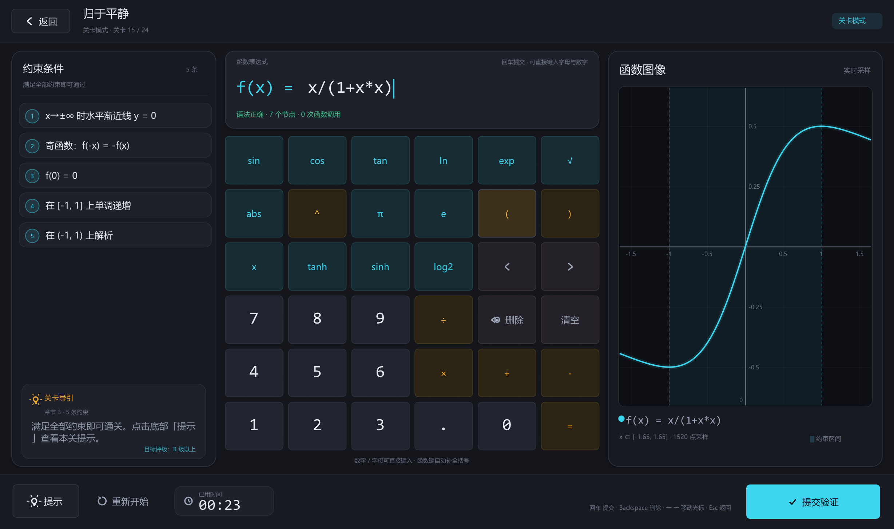

# 函数工坊 FunctionCraft

> 在约束之中，构造属于你的函数。

用**符号计算引擎**驱动的数学解谜游戏：给出若干限定条件（函数库、定义域、解析性、单调性、渐近线、零点数…），
你用计算器键盘写一个函数，引擎严格验证并给出多维评分。



```
关卡 1-1「余弦的微笑」
  约束：① 偶函数   ② f(0) = 1
  你的答案：cos(x)          → S   100 分
  别人的答案：x^2*0+cos(x)  → A   84.6 分   （能做对，但不够优雅）
```

---

## 特性

| | |
|---|---|
| **符号验证** | 15 种约束全部用符号推理判定，不是数值采样近似 |
| **域安全化简** | `x/x` 不会化成 `1`，`sqrt(x²)` 只能是 `|x|`——杜绝"假通过" |
| **四维评分** | 精确度 / 优雅度 / 鲁棒性 / 时间，`×0` 填充式作弊会被扣分 |
| **三种模式** | 24 关战役（4 章）+ 程序化无尽模式 + 限时挑战 |
| **高 DPI** | Per-Monitor DPI V2，2560×1600@175% / 4K@200% 原生清晰 |
| **多画幅** | 16:9 / 16:10 / 21:9 / 4:3，超宽屏限宽居中，小屏自动紧凑布局 |

---

## 快速开始

### 直接玩

到 [Releases](../../releases) 下载 `FunctionCraft-win64.zip`，解压后双击 `FunctionCraft.exe`
（需要 Windows 10/11 + DirectX 11，无需安装任何运行库）。

### 从源码构建

**环境**：Visual Studio 2022（MSVC 14.4+）、CMake 3.20+、Ninja。

```bat
cd cpp
build.bat        :: 配置 + 编译
test.bat         :: 编译 + 跑全部测试
build\bin\FunctionCraft.exe
```

> `build.bat` 内置了本机工具链路径（VS 在 `D:\VS`，CMake/Ninja 在 STM32CubeCLT）。
> 换机器时改 `build.bat` 顶部的 `PATH` 与 `vcvarsall.bat` 路径即可。

---

## 玩法

**输入**：计算器键盘（鼠标点）或直接键盘输入，支持隐式乘法（`2x`、`3sin(x)`）。

**约束类型（15 种）**：函数库白名单、定义域、解析性、边界值、值域、恒正、单调性、奇偶性、
周期性、水平渐近线、极值、对称轴、零点个数、复杂度上限、中心对称。

**评分**

```
总分 = 100 × (0.35·精确度 + 0.30·优雅度 + 0.25·鲁棒性 + 0.10·时间)
评级：S ≥ 90 / A ≥ 80 / B ≥ 70 / C ≥ 60 / 其余 D
```

- 精确度：边界值、值域类约束的数值误差
- 优雅度：函数调用数 / 节点数 / 嵌套深度与参考解比较（`×0` 填充会被扣分）
- 鲁棒性：约束区间端点内缩/外扩处是否依然成立
- 时间：限时模式的剩余时间

---

## 项目结构

```
cpp/
├── CMakeLists.txt
├── build.bat / test.bat          # 一键构建 / 测试
├── src/
│   ├── core/                     # 符号引擎（无第三方依赖，可独立复用）
│   │   ├── Expr.h/.cpp             表达式树：不可变节点、优先级感知打印、哈希
│   │   ├── Parser.h/.cpp           词法 + 递归下降（隐式乘法、Unicode π/√/×/÷）
│   │   ├── Numeric.h/.cpp          复数求值
│   │   ├── Simplify.h/.cpp         域安全化简、符号等价判定（数值兜底）
│   │   ├── Diff.h/.cpp             符号求导（全算子 + 任意阶）
│   │   ├── Domain.h/.cpp           定义域、解析性、单调性、值域、零点
│   │   ├── Limit.h/.cpp            极限与渐近线（Aitken Δ² 外推）
│   │   ├── Constraint.h/.cpp       15 种约束的验证器
│   │   ├── Scoring.h/.cpp          多维评分
│   │   ├── Level.h/.cpp            关卡 JSON 加载
│   │   ├── EndlessGen.h/.cpp       无尽模式生成（先造解、再反推约束）
│   │   └── Json.h/.cpp             极简 JSON
│   ├── ui/                       # Dear ImGui + DirectX 11 界面
│   └── tools/cli.cpp             # 命令行自检工具
├── data/levels.json              # 24 关关卡数据
├── tests/                        # 172 个单元/集成测试（自带极简框架）
└── third_party/                  # Dear ImGui、stb_image_write
```

---

## 技术要点

1. **AST 与数值类型无关**：`Op` 枚举统一描述实数/复数/多变量运算，为复变函数、多元函数扩展留好接口。
2. **符号优先**：解析性、单调性、奇偶性、周期性都用符号判定；符号化简失败时才回退数值采样兜底。
3. **域安全化简**：化简不允许改变定义域，否则约束验证会出现假阳性。
4. **关卡可解性保证**：无尽模式先生成参考解，再由参考解反推约束（采样判定奇偶性/单调性/值域/零点/渐近线），确保关关可解。
5. **性能**：单次提交评分 0.01–3.7 ms；符号化简典型耗时 0.065 ms。

---

## 测试与自检

```
172 个测试全绿 = AST/解析/求值(8) + 化简与求导(40) + 定义域与极限(77)
                            + 玩法系统(35) + 跨模块集成(12)
```

```bat
build\fcg_tests.exe                                    :: 全部测试
build\fcg_cli.exe verify  data\levels.json             :: 24 关参考解约束自洽
build\fcg_cli.exe check   data\levels.json 1-1 "cos(x)":: 用任意表达式检查某关
build\fcg_cli.exe endless 12345 20                     :: 生成无尽关卡并自检
build\fcg_cli.exe bench   data\levels.json 4-6 "exp(-x*x)" 20  :: 评分耗时基准

:: 界面截图（离屏渲染，不受显示器限制）
build\bin\FunctionCraft.exe --shot=shots\play.png --size=2520x1575 --dpi-scale=1.75 --scene=play
shots_matrix.sh                                        :: 6 组画幅 × 5 界面的截图矩阵
```

集成测试覆盖：24 关参考解全部满足约束、常见正确解被接受、常见错误解被拒绝、
打印→解析→符号等价回环、评分单调性、失败归零、限时加成、无尽模式 180 关可解性、提交性能。

---

## 开发状态

**v0.2（可玩）**：24 关战役 + 无尽模式 + 限时模式、四维评分、存档、高 DPI 与多画幅适配。

**路线图**

- [ ] 关卡数量扩充到 60–80 关
- [ ] 关卡工坊（UGC：编辑器 + 分享码）
- [ ] 音效与动效
- [ ] 每日挑战 + 解复杂度直方图
- [ ] 复数域（柯西-黎曼、留数、洛朗展开）
- [ ] 多变量函数（3D 图像、梯度/Hessian）

---

## 其他目录

- `docs/screenshots/` — 游戏截图（2560×1600@175% 实机分辨率）
- `函数约束游戏-设计大纲.md` — 最初的设计文档：玩法、评分、约束体系、扩展路线
- `game/` — 最早的 Python 原型（`symbolic.py`，验证玩法用的符号引擎雏形，已被 C++ 实现取代，保留供参考）

---

## 许可

暂未开源授权（All rights reserved）。如需合作或授权请联系作者。
